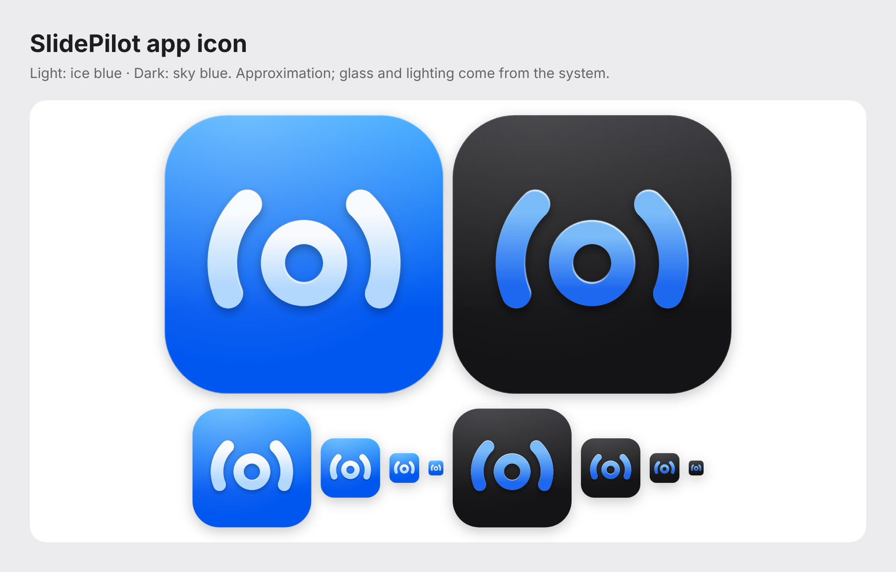

# App icon

The app icon is an Icon Composer document: [`SlidePilot/Resources/AppIcon.icon`](../../../SlidePilot/Resources/AppIcon.icon).

The preview is an approximation rendered from the SVGs. Open the `.icon` document in Icon Composer to see the real Liquid Glass rendering in all appearances.

## Glyph

The glyph reduces the yoke of the old SlidePilot icon to two simple shapes with thick, round strokes, like Apple's own app icons. Each shape is its own group, so Liquid Glass gives it depth:

| Layer | Content |
|---|---|
| `hub` (front) | Hub ring (outer radius 158, inner radius 70) |
| `horns` (back) | Two arcs around the hub (radius 300, stroke 108): the hinted handles of the yoke |

All values are in points on the 1024 × 1024 canvas. The arcs leave a gap of 88° at the top and 136° at the bottom, so they reach further up than down. The glyph sits 59 points below the canvas center to look optically centered.

The SVGs are white; the colors come from the fills in `icon.json`.

## Colors

One hue, styled like Apple's own app icons (e.g. Pages): a vivid background and a glyph in lighter tints of the same hue.

| Appearance | Background | Glyph |
|---|---|---|
| Light ("ice blue") | `#3DA8FF` → `#0057F0` | `#FFFFFF` → `#B8DCFF` |
| Dark ("sky blue") | `#3A3A3E` → `#141416` | `#7DC0FF` → `#1E6BF5` |

Clear and tinted appearances are derived by the system.
