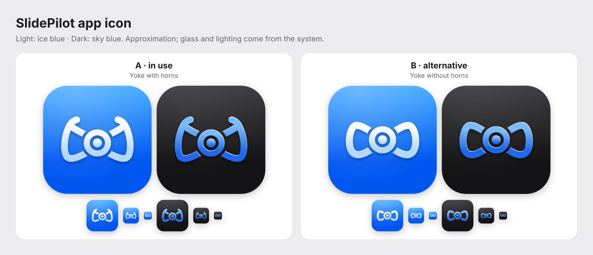

# App icon

The app icon is an Icon Composer document: [`SlidePilot/Resources/AppIcon.icon`](../../../SlidePilot/Resources/AppIcon.icon). It is a copy of [`SlidePilot-A.icon`](SlidePilot-A.icon).

The preview is an approximation rendered from the SVGs. Open the `.icon` documents in Icon Composer to see the real Liquid Glass rendering in all appearances.

## Glyph

The glyph modernizes the yoke of the old SlidePilot icon. Each part is its own group, so Liquid Glass gives it depth:

| Layer | Content |
|---|---|
| `dot` (front) | Center dot |
| `hub` | Hub ring |
| `yoke` (back) | The two handles, with a gap to the hub |

- **A** (in use): handles with horns, close to the old icon.
- **B** (alternative): simpler, D-shaped handles without horns.

The SVGs are white on a 1024 × 1024 canvas; the colors come from the fills in `icon.json`.

## Colors

One hue, styled like Apple's own app icons (e.g. Pages): a vivid background and a glyph in lighter tints of the same hue.

| Appearance | Background | Glyph |
|---|---|---|
| Light ("ice blue") | `#3DA8FF` → `#0057F0` | `#FFFFFF` → `#B8DCFF` |
| Dark ("sky blue") | `#3A3A3E` → `#141416` | `#7DC0FF` → `#1E6BF5` |

Clear and tinted appearances are derived by the system.

To switch to glyph B, replace `SlidePilot/Resources/AppIcon.icon` with a copy of `SlidePilot-B.icon`.
