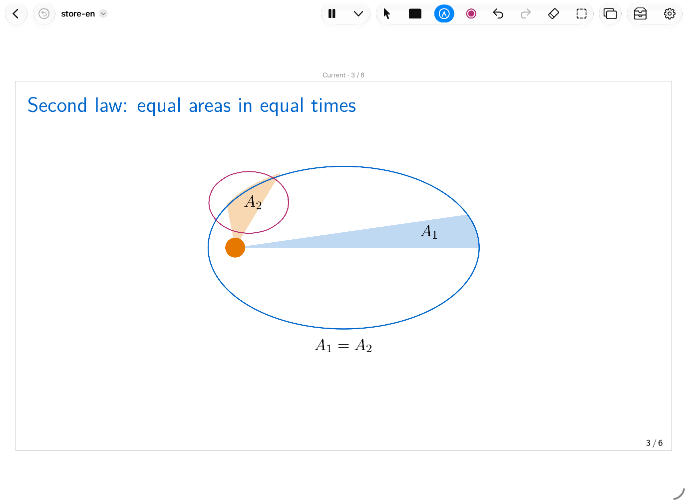

# Drawing

Draw on the current slide while the audience watches. Start with **D** or the **Draw** button in the toolbar; end with the same button or Esc.

While you draw, the presenter view shows only the current slide, and the toolbar shows the drawing tools:

- **Color**: black, white, blue, green, magenta or orange.
- **Clear**: removes all strokes from the slide (⌃C).
- **White Canvas**: draws on a white sheet instead of the slide (⌃⇧K); ⌃K goes back to the slide. Switching clears the strokes.
- **Undo and Redo**: ⌘Z and ⇧⌘Z, the undo gestures, or the buttons on iPad and iPhone.

Draw with the mouse or trackpad on the Mac, and with a finger or Apple Pencil on iPad and iPhone.

**Apple Pencil**: double-tap (or squeeze an Apple Pencil Pro) does what you chose in the system's Apple Pencil settings: switch to the previous color, or show the colors.

## Keeping drawings

By default, drawings disappear when you stop drawing, and you cannot change slides while drawing. Turn on **Settings ▸ General ▸ Save drawings** to:

- keep each slide's drawing when you change slides or stop drawing,
- change slides while drawing,
- store the drawings with the PDF, so they are still there after reopening it.

Turning the setting off again deletes the saved drawings of all PDFs, after asking.

## Exporting drawings

**Export Drawings…** (⌥⌘E) creates a copy of the PDF with your drawings on the slides, for example to share them after a lecture. On the Mac it is in the **File** menu; on iPad and iPhone in the **Import and Export** menu.

A [curtain](curtain.md) hides the drawing from the audience; the drawing is still there when the curtain goes away.
