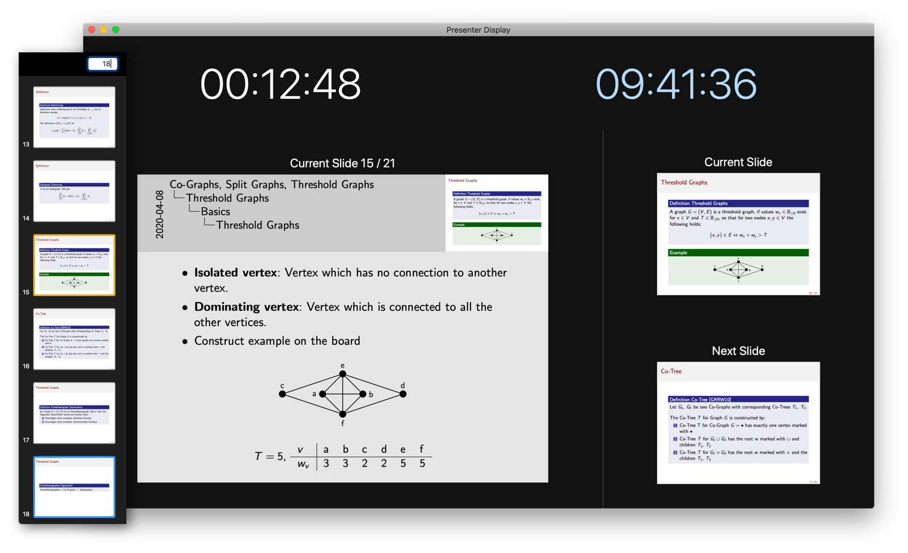

# Overview

## SlidePilot

SlidePilot is a powerful tool for presenting PDFs on macOS. SlidePilot was made with the focus on supporting notes created with LaTex Beamer but it works just as good with any normal PDF presentation.

