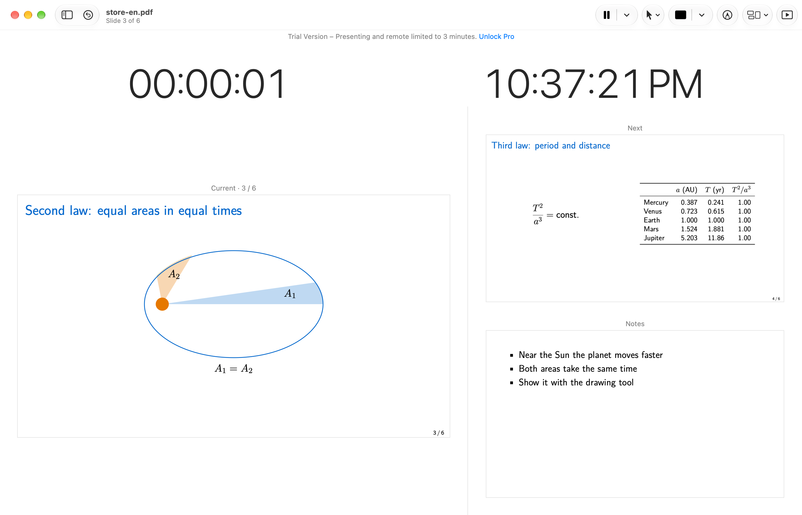

SlidePilot presents PDF slides on Mac, iPad and iPhone. It is made for LaTeX Beamer decks and works just as well with any other PDF.

While the audience sees only the current slide, you see your **presenter view**: the current and next slide, your notes, a clock and a timer. From there you can point at the slide, draw on it, hide it behind a curtain, or control everything from another device.

## Requirements

SlidePilot runs on **macOS 26**, **iPadOS 26** and **iOS 26** or later. It is one app for all three: notes, drawings and settings work the same on every device.

## Getting started

1. Open a PDF: on the Mac with **File ▸ Open…** (⌘O) or by opening it with SlidePilot in the Finder; on iPad and iPhone in the document browser that SlidePilot shows at launch.
2. Connect a second screen, a projector or an AirPlay receiver. SlidePilot shows the presentation there. See [Presenting](/features/presenting/).
3. Change slides with the arrow keys, a presentation clicker or a swipe. The timer starts with the first slide change.

Several PDFs can be open at the same time, each in its own window. When you recompile a PDF (for example with LaTeX), SlidePilot reloads it right away and stays on the current slide.

## What's in SlidePilot

| Feature | What it does |
|---|---|
| [Presenting](/features/presenting/) | Second screen, external display and AirPlay; changing slides; links |
| [Layout](/features/layout/) | Which slides you see in the presenter view, and the slide navigator |
| [Timing](/features/timing/) | Clock, stopwatch and timer with warnings |
| [Notes](/features/notes/) | Text notes per slide, or Beamer notes on the slide itself |
| [Drawing](/features/drawing/) | Draw on the slide with the mouse, a finger or Apple Pencil |
| [Curtain](/features/curtain/) | Hide the slide behind a black or white screen |
| [Pointer](/features/pointer/) | Point at the slide; pick or design the pointer |
| [Remote Control](/features/remote/) | Control a presentation from another iPhone, iPad or Mac |
| [Beamer and LaTeX](/features/beamer/) | Notes on the second screen, videos and links in your deck |
| [Keyboard Shortcuts](/features/shortcuts/) | Every shortcut on one page |

SlidePilot is free. Presenting to an audience and remote control are unlimited with [SlidePilot Pro](/pro/) and can be tried for 3 minutes at a time without it.
